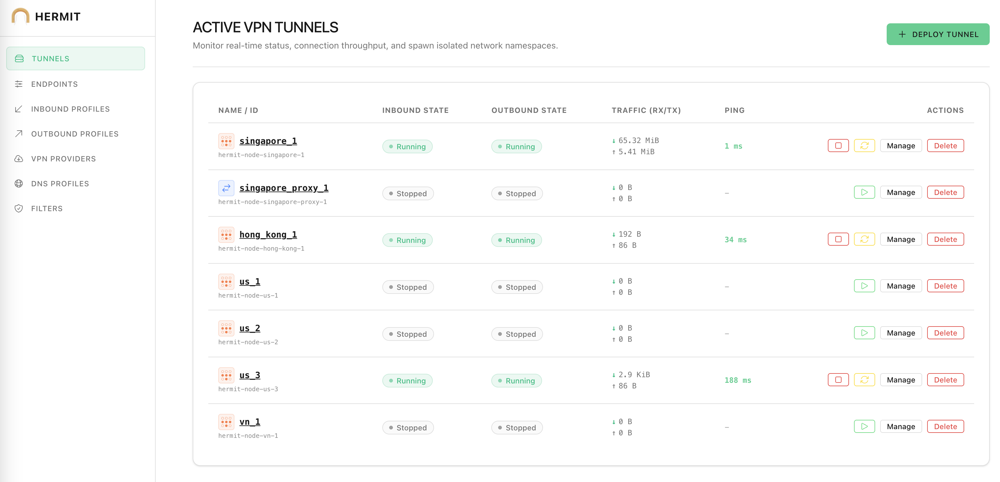
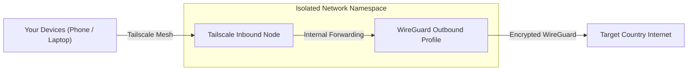

<h1 align="center">
   Hermit
</h1>

<p align="center">
  <strong>The Self-Hosted All-in-One Network & Privacy Gateway</strong><br>
  Encrypted Ad-Blocking DNS (DoH / Tailscale) + Multi-Tunnel VPN Mesh Orchestrator.
</p>

<p align="center">
  <a href="https://github.com/quaywin/hermit/releases"></a>
  <a href="https://github.com/quaywin/hermit/blob/main/LICENSE"></a>
  <a href="https://elixir-lang.org"></a>
  <a href="https://phoenixframework.org"></a>
  <a href="https://github.com/quaywin/hermit/pkgs/container/hermit"></a>
</p>

<p align="center">
  
</p>

---

## ⚡ What is Hermit?

**Hermit** turns any Linux machine or cheap VPS into a private, high-performance security hub for all your personal devices:

1. 🛡️ **Encrypted DNS & Ad-Blocking Control Plane**: A self-hosted alternative to NextDNS / Control D / AdGuard Home. Filter ads, malware, and trackers with built-in blocklists (AdGuard, GoodbyeAds, Adult filters) and custom routing rules. Deploy via secure **DNS-over-HTTPS (DoH)**, **Android Private DNS**, **Apple `.mobileconfig` (1-click install)**, or dedicated **Tailscale Mesh DNS Nodes**.
2. 🌐 **Multi-Tunnel VPN Orchestrator**: Pair incoming connections (**Tailscale nodes**, **SOCKS5/HTTP proxies**) with outgoing VPN gateways (**WireGuard**, **Host Direct**) running in completely **isolated Linux network namespaces (`netns`)**. Zero port conflicts, zero route leaks, and zero impact on your host network.
3. 🔀 **Domain-Based Split Tunneling (Smart DNS & SNI Proxy)**: Route specific geo-restricted domains (`netflix.com`, `*.openai.com`, etc.) through designated VPN tunnels automatically without needing an Exit Node or installing VPN clients on your device. Zero SSL certificate errors, zero battery drain.
4. 📊 **Real-Time Web Dashboard**: Built with Phoenix LiveView. Monitor 24-hour DNS telemetry, query volume, blocked threats, throughput, ping latencies, and device status with real-time updates and zero polling overhead.

---

## 🚀 Quick Start (1-Minute Setup)

Hermit is distributed as a multi-arch Docker image supporting both **x86_64 (`amd64`)** and **ARM64 (`arm64`)** (Apple Silicon, AWS Graviton, Raspberry Pi, Oracle Cloud ARM, etc.).

### Option A: Automated 1-Line Installer (Recommended)

The automated script checks prerequisites, prepares persistent storage (`~/.hermit/storage`), generates secure random credentials, sets up Docker permissions, and installs the global `hermit` CLI shortcut:

```bash
curl -fsSL https://raw.githubusercontent.com/quaywin/hermit/main/install.sh | bash
```

Once completed, the terminal outputs your access details:
* **Web Dashboard**: `http://<your-server-ip>:3000` (or `http://localhost:3000`)
* **Default Username**: `admin`
* **Password**: *Randomly generated and printed in your terminal (saved at `~/.hermit/env`)*

---

### Option B: Docker Compose (Manual Setup)

If you prefer managing files yourself:

1. **Create directories and configuration**:
   ```bash
   mkdir -p ~/.hermit/storage
   
   cat <<EOF > ~/.hermit/env
   SECRET_KEY_BASE=$(openssl rand -base64 48 | tr -d '\n')
   PHX_HOST=localhost
   HERMIT_PORT=3000
   HERMIT_BASIC_AUTH_USER=admin
   HERMIT_BASIC_AUTH_PASS=choose_your_password
   EOF
   ```

2. **Download `docker-compose.yml`**:
   ```bash
   curl -fsSL https://raw.githubusercontent.com/quaywin/hermit/main/docker-compose.yml -o ~/.hermit/docker-compose.yml
   ```

3. **Start Hermit**:
   ```bash
   docker compose -f ~/.hermit/docker-compose.yml up -d
   ```

---

## 🎯 Common Use Cases & How It Works

### Use Case 1: Protect Devices with Encrypted Ad-Blocking DNS (DoH)

Stop ads, tracking, and telemetry on all your phones, laptops, and home browsers without installing client apps:

1. Open Hermit Web Dashboard $\rightarrow$ Click **Endpoints** in the sidebar.
2. An Endpoint is pre-created with default ad-blocking filters enabled.
3. Click the 📖 **Setup Guide** button next to the DoH URL:
   * **Android**: Copy your hostname $\rightarrow$ Go to *Settings > Network & internet > Private DNS* $\rightarrow$ Paste hostname.
   * **iPhone / iPad / Mac**: Click **Download Apple Profile (`.mobileconfig`)** $\rightarrow$ Tap *Install* in Settings.
   * **Chrome / Brave / Edge**: Go to *Settings > Privacy and security > Security > Use secure DNS* $\rightarrow$ Select *Custom* and paste your DoH URL.
   * **Firefox**: Go to *Settings > Privacy & Security > DNS over HTTPS* $\rightarrow$ Select *Max Protection* $\rightarrow$ Paste your DoH URL.
4. Watch blocked requests appear in real-time on your **Dashboard**!

---

### Use Case 2: Multi-Tunnel VPN Mesh (Tailscale + WireGuard)

Route your traffic from anywhere in the world through a trusted WireGuard VPN provider (Mullvad, Proton, NordVPN, IVPN, etc.) using Tailscale:



1. **Add Inbound Profile** (`/inbounds`):
   * Select **Tailscale** $\rightarrow$ Enter your Tailscale Auth Key (`tskey-auth-...` or OAuth `tskey-client-...`).
2. **Add Outbound Profile** (`/outbounds`):
   * Paste your WireGuard configuration (`.conf` file or private key, server endpoint, address).
3. **Deploy Tunnel** (`/`):
   * Pair your Inbound and Outbound profiles $\rightarrow$ Click **Deploy Tunnel**.
   * Hermit will spawn an isolated network namespace, boot the Tailscale node, establish the WireGuard connection, and configure routing rules.
4. On your phone or laptop, simply open the Tailscale app and select `hermit-node-...` as your **Exit Node**!

---

### Use Case 3: Domain-Based Split Tunneling (Smart DNS & SNI Proxy)

Stream geo-restricted media (e.g. Netflix US, BBC iPlayer) or unblock services (e.g. OpenAI) on your Smart TV, phone, or laptop without routing all your computer's traffic through a full VPN exit node:

```mermaid
flowchart LR
    Client["Client (Phone / TV / PC)\n(Only sets Hermit DNS)"] -->|1. Query netflix.com| DNS["Hermit Smart DNS\n(:53 / DoH)"]
    DNS -->|2. Returns Hermit IP| Client
    Client -->|3. HTTPS port 443\n(TLS ClientHello)| SNI["Transparent SNI Proxy\n(Ports 443 / 80)"]
    subgraph Tunnel ["Isolated Tunnel Netns"]
        SNI -->|4. SOCKS5 Relay| SOCKS["microsocks Daemon"]
        SOCKS -->|5. WireGuard Outbound| Target["US WireGuard Gateway\n(netflix.com)"]
    end
    Client -.->|Normal traffic (e.g. google.com)\nDirect local ISP connection| Internet["Direct Internet"]
```

1. Open your tunnel's detail page on Hermit.
2. In the unified **Routing Targets (Split-Tunnel)** box, enter your targets:
   * **Domains** (e.g. `netflix.com, *.openai.com`): Automatically intercepted via Smart DNS & SNI Proxy.
   * **IP Subnets** (e.g. `192.168.1.0/24, 10.0.0.0/8`): Automatically advertised via Tailscale Subnet Router.
3. Configure your device or home router to use Hermit's DNS.
4. Enjoy transparent domain-level split tunneling with **zero client VPN apps** and **zero SSL certificate errors**!

---

## 🛠️ Everyday Management via `hermit` CLI

The installer creates a lightweight `hermit` CLI helper on your server:

```bash
hermit status    # View container status, uptime, and port mappings
hermit logs      # Follow live container logs
hermit restart   # Restart Hermit container
hermit update    # Pull latest image and seamlessly upgrade
hermit env       # View web credentials and environment variables
hermit stop      # Stop Hermit container
hermit start     # Start Hermit container
```

---

## 🔄 Frictionless Upgrades

Hermit preserves all your database records, tokens, and active tunnel states across upgrades:

* **1-Click Web Upgrade (Zero Terminal)**:
  Navigate to **Settings** (`/settings`) on the web dashboard. When an update is released, click **[Upgrade]** — Hermit pulls the latest image and restarts seamlessly in ~10 seconds.
* **Terminal Upgrade**:
  ```bash
  hermit update
  # or re-run the 1-line installer:
  curl -fsSL https://raw.githubusercontent.com/quaywin/hermit/main/install.sh | bash
  ```

---

## ⚙️ Configuration & Reference

<details>
<summary><strong>Port Reference & Firewall Guide</strong></summary>

When running in standard Production Mode (`network_mode: host`):

| Port / Protocol | Service | Description |
| :--- | :--- | :--- |
| **`3000/tcp`** | Web Dashboard & DoH | Phoenix LiveView Web UI and DoH resolver (`/dns-query/:token`). Customizable via `HERMIT_PORT`. |
| **`443/tcp, 80/tcp`** | Smart DNS SNI Proxy | Transparent SNI proxy for domain-based split tunneling (Zero-crypto raw TCP streaming). |
| **`Dynamic UDP`** | Tailscale Inbounds | **Zero-config**: Automatically allocates free ephemeral ports (`41642-41700`) for direct P2P connections. |
| **`53/udp, tcp`** | Port 53 DNS | Standard DNS resolver (optional fallback or for LAN router upstream). |

> [!TIP]
> **Co-existing with Host Tailscale & Services**:
> Because each VPN pair and DNS node runs in an isolated Linux network namespace (`netns`), Hermit will **never conflict** with your host's Tailscale daemon (`41641/udp`) or interrupt your SSH sessions.
</details>

<details>
<summary><strong>Tailscale ACL & OAuth Client Setup (`tag:hermit`)</strong></summary>

When registering Tailscale Inbound nodes or DNS Endpoints with OAuth client keys (`tskey-client-...`), Tailscale requires devices to declare an ACL tag.

1. **Tag Declaration (`tag:hermit`)**:
   Add this to your [Tailscale Admin Console → Access Controls (ACL)](https://login.tailscale.com/admin/acls):
   ```json
   {
     "tagOwners": {
       "tag:hermit": ["autogroup:admin"]
     }
   }
   ```

2. **Auto-Approving Exit Node Routes (Recommended)**:
   To let Hermit tunnels act as Exit Nodes automatically without manual approval:
   ```json
   {
     "autoApprovers": {
       "exitNode": ["tag:hermit"],
       "routes": {
         "0.0.0.0/0": ["tag:hermit"],
         "::/0": ["tag:hermit"]
       }
     }
   }
   ```
</details>

<details>
<summary><strong>High-Throughput Performance Tuning (UDP GRO)</strong></summary>

Hermit automatically enables UDP GRO offloading on virtual interfaces inside network namespaces.

For maximum throughput (especially on 1Gbps+ connections), enable UDP GRO on your host's physical network interface once:
```bash
sudo sh -c 'ethtool -K $(ip -o route get 8.8.8.8 | cut -f 5 -d " ") rx-udp-gro-forwarding on rx-gro-list off'
```
</details>

<details>
<summary><strong>Local Development Mode</strong></summary>

To develop or modify Hermit locally with live code reload:

```bash
git clone https://github.com/quaywin/hermit.git
cd hermit
docker compose -f docker-compose.dev.yml up -d
```
The Phoenix server will reload code changes incrementally in `< 0.5s`.
</details>

---

## 💡 Why Network Namespaces (`netns`) & Docker?

Running multiple VPN tunnels simultaneously on a single Linux machine normally creates severe routing table conflicts (e.g., conflicting `default` gateways and overlapping subnet routes).

Hermit solves this by assigning every connection pair its own **Linux Network Namespace (`netns`)** and **`nftables`** rules:
* Each tunnel has its own independent virtual network interfaces and routing table.
* The container runs with `privileged: true` solely to manage namespaces and network interfaces.
* Your host operating system remains clean and unaffected.

---

## 📜 License & Credits

Hermit is open-source software licensed under the [MIT License](LICENSE).

Built with appreciation for:
* **[WireGuard](https://www.wireguard.com/)** - Modern, secure, and fast VPN protocol.
* **[Tailscale](https://tailscale.com/)** - Effortless private overlay mesh networking.
* **[AdGuard Home](https://github.com/AdguardTeam/AdGuardHome)** & **[GoodbyeAds](https://github.com/jerryn70/GoodbyeAds)** - Comprehensive ad-blocking filter lists.
* **[Elixir](https://elixir-lang.org/)** & **[Phoenix LiveView](https://phoenixframework.org/)** - For enabling real-time reactivity with minimal footprint.
