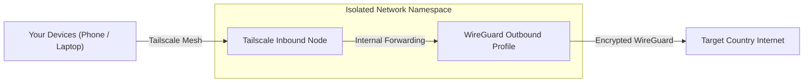
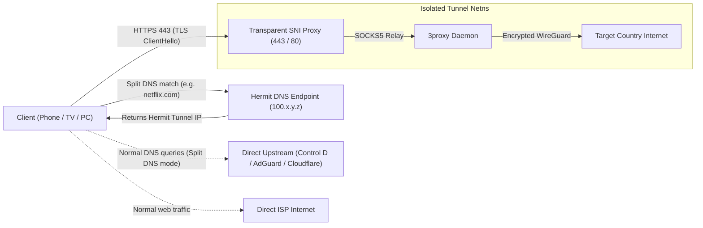

<h1 align="center">
   Hermit
</h1>

<p align="center">
  <strong>The Self-Hosted All-in-One Network & Privacy Gateway</strong><br>
  Tailscale Mesh Ad-Blocking DNS + Multi-Tunnel VPN Mesh Orchestrator.
</p>

<p align="center">
  <a href="https://github.com/quaywin/hermit/releases"></a>
  <a href="https://github.com/quaywin/hermit/blob/main/LICENSE"></a>
  <a href="https://elixir-lang.org"></a>
  <a href="https://phoenixframework.org"></a>
  <a href="https://github.com/quaywin/hermit/releases/latest"></a>
</p>

<p align="center">
  
</p>

---

## ⚡ What is Hermit?

**Hermit** turns any Linux machine or cheap VPS (Debian, Ubuntu, Raspberry Pi OS 64-bit) into a private, high-performance security hub for all your personal devices:

1. 🛡️ **Cloud DNS Filtering & Tailscale Split DNS Auto-Sync**: Block ads, malware, and trackers across your Tailnet using upstream filtering presets (**Control D**, **Control D Community Lists**, **AdGuard DNS**, **Cloudflare**, **Quad9**) or custom DoH/UDP resolvers, paired with HTTP/2 DoH pooling, optimistic caching, and automatic **Tailscale Split DNS** / **Global DNS** syncing.
2. 🌐 **Multi-Tunnel VPN Orchestrator**: Pair incoming connections (**Tailscale nodes**, **SOCKS5/HTTP proxies**) with outgoing VPN gateways (**WireGuard**, **Host Direct**) running in completely **isolated Linux network namespaces (`netns`)**. Zero port conflicts, zero route leaks, and zero impact on your host network.
3. 🔀 **Domain-Based Split Tunneling (Smart DNS & SNI Proxy)**: Route specific geo-restricted domains (`netflix.com`, `*.openai.com`, etc.) through designated VPN tunnels automatically without needing an Exit Node or installing VPN clients on your device. Zero SSL certificate errors, zero battery drain.
4. 📊 **Real-Time Web Dashboard**: Built with Phoenix LiveView. Monitor 24-hour DNS telemetry, query volume, blocked threats, throughput, ping latencies, and device status with real-time updates and zero polling overhead.

---

## 🚀 Quick Start (Remote 1-Line Installer)

Hermit runs as a high-performance, native Linux systemd service on **x86_64 (`amd64`)** and **ARM64 (`arm64`)** (Raspberry Pi 64-bit, AWS Graviton, Oracle Cloud ARM, Debian/Ubuntu VPS).

To install or upgrade Hermit on any Linux server remotely:

```bash
curl -fsSL https://raw.githubusercontent.com/quaywin/hermit/main/install.sh | sudo bash
```

### What the installer handles automatically:
* Installs minimal Linux networking tools (`nftables`, `wireguard-tools`, `ethtool`, etc.) without installing host proxy services.
* Isolates `tailscale`, `tailscaled`, and `3proxy` binaries under `/opt/hermit/bin/` so your host `/usr/local/bin` and system configuration remain clean.
* Downloads and verifies the precompiled native release tarball (`SHA256SUMS`) for your CPU architecture.
* Automatically migrates legacy database records and settings if upgrading from Docker (`~/.hermit/storage` $\rightarrow$ `/var/lib/hermit`).
* Sets up and starts `hermit.service` via `systemd` under `/opt/hermit`.
* Creates the global `hermit` CLI helper.

Once completed, the terminal outputs your access details:
* **Web Dashboard**: `http://<your-server-ip>:3000` (or `http://localhost:3000`)
* **Default Username**: `admin`
* **Password**: *Printed in your terminal (stored securely in `/etc/hermit/env`)*

---

### Non-Interactive / Automation Flag (`-y`)

For automated server deployments (Ansible, Cloud-init, CI/CD), pass `-y` to skip all prompts and use defaults/existing settings:

```bash
curl -fsSL https://raw.githubusercontent.com/quaywin/hermit/main/install.sh | sudo bash -s -- -y
```

---

## 🎯 Common Use Cases & How It Works

### Use Case 1: Tailnet-Wide Cloud DNS Filtering & Auto-Sync

Stop ads, trackers, and malicious domains across your entire Tailscale network with zero manual Tailscale DNS tweaks and zero device-side SSL certificates:

1. Open Hermit Web Dashboard $\rightarrow$ Go to **DNS** (`/dns`) and pick an upstream filtering provider:
   * Built-in presets: **Control D** (Ads & Tracking by default), **Control D Community Lists** (`HaGeZi`, `OISD`, `1Hosts`), **AdGuard DNS**, **Cloudflare**, or **Quad9** (UDP or DoH).
   * Or enter a **Custom** resolver (Control D Personal, NextDNS, RethinkDNS, or IP).
2. Go to **DNS Endpoints** (`/dns/endpoints`) and activate a Tailscale DNS Endpoint linked to your Tailscale OAuth Inbound Profile.
3. Click **`TS DNS`** (`TS DNS: ON`) and choose your Tailscale routing mode from the dropdown:
   * **`Split DNS` (Default — Fastest)**: Tailscale Global Nameservers point directly to your upstream provider (e.g., Control D / AdGuard / NextDNS) so 99% of normal & ad-blocked traffic resolves in 1 hop without hitting your VPS, while Hermit automatically syncs your **Smart DNS / Block / Bypass / Redirect** domains to Tailscale **Split DNS** pointing to Hermit (`100.x.y.z`).
   * **`Global DNS`**: Routes all Tailnet DNS queries through Hermit (`100.x.y.z`) for full real-time query logs and telemetry.
   * **Automatic `DoH Fallback`**: If you use a community list or custom DoH URL not natively whitelisted by Tailscale (e.g., `freedns.controld.com/x-hagezi-pro`), Hermit automatically switches Tailscale sync to **Global DNS** so upstream filtering stays active.

---

### Use Case 2: Multi-Tunnel VPN Mesh (Tailscale + WireGuard)

Route your traffic from anywhere in the world through a trusted WireGuard VPN provider (Mullvad, Proton, NordVPN, IVPN, etc.) using Tailscale:



1. **Add Inbound Profile** (`/inbounds`):
   * Select **Tailscale** $\rightarrow$ Enter your Tailscale Auth Key (`tskey-auth-...` or OAuth `tskey-client-...`).
2. **Add Outbound Profile** (`/outbounds`):
   * Paste your WireGuard configuration (`.conf` file or private key, server endpoint, address).
3. **Deploy Tunnel** (`/`):
   * Pair your Inbound and Outbound profiles $\rightarrow$ Click **Deploy Tunnel**.
   * Hermit will spawn an isolated network namespace, boot the Tailscale node, establish the WireGuard connection, and configure routing rules.
4. On your phone or laptop, simply open the Tailscale app and select `hermit-node-...` as your **Exit Node**!

---

### Use Case 3: Domain-Based Split Tunneling (Smart DNS & SNI Proxy)

Stream geo-restricted media (e.g., Netflix US, BBC iPlayer) or unblock services (e.g., OpenAI) on your Smart TV, phone, or laptop without routing all your traffic through a full VPN exit node:



#### Why Smart DNS is Faster & Better than a Full Exit Node:
* ⚡ **Zero VPS DNS Hop in Split DNS Mode**: Normal DNS lookups go straight from your devices to your chosen Cloud DNS provider, while Tailscale **Split DNS** automatically forwards only configured Smart DNS / Block / Bypass domains to Hermit. Normal browsing stays on your direct ISP connection at full speed.
* 🚀 **Low Latency Handshake**: TLS ClientHello connections to Hermit occur over fast Tailscale P2P / LAN (1–5ms RTT), avoiding round-trip penalties across the globe on initial connection.
* 🛡️ **Bypasses ISP IP & DPI Blocks**: Because DNS returns Hermit's IP, your device never attempts to connect directly to the target server's IP. All web content (HTML, media, video streams) is fetched through the WireGuard tunnel at the destination country and proxied back to you.
* 🚫 **No CAPTCHAs**: Normal browsing retains your clean residential ISP IP, preventing annoying Cloudflare/Google robot checks.
* 🔋 **Zero Battery Drain & Zero Client Apps**: Smart TVs, Apple TVs, gaming consoles, and mobile devices only need Tailscale connected (with Exit Node **OFF**) or Hermit set as DNS.

#### How to Configure:
1. Deploy your Tunnel pair (e.g. Tailscale Inbound + WireGuard Outbound) on the **Dashboard** (`/`).
2. Route domains or streaming services through the tunnel:
   * **1-Click Smart DNS Services** (`/dns/services`): Select popular platforms (Netflix, OpenAI / ChatGPT, BBC iPlayer, etc.) and set action to **Route to Tunnel**, **Block**, or **Bypass**. All associated CDN and static asset domains are handled automatically.
   * **Custom Domain Rules** (`/dns/rules`): Add custom domain patterns (e.g. `*.openai.com`, `example.com`) with actions (**Route to Tunnel**, **Block**, **Bypass**, **Redirect**, **Forward DNS**, or **Forward Proxy**).
   * *(Optional)* **IP Subnet Routing**: To route private LAN or VPC subnets (e.g. `192.168.1.0/24`), enter them under **Advertised Subnets** in the tunnel's settings.
3. On **DNS Endpoints** (`/dns/endpoints`), enable **`TS DNS`** (`Split DNS` or `Global DNS`). Hermit automatically normalizes domain suffixes (e.g., `*.netflix.com` $\rightarrow$ `netflix.com`, matching all subdomains on Tailscale Split DNS) and keeps Tailscale DNS synced automatically whenever you update services, rules, or upstream resolvers.
4. Enjoy transparent domain-level split tunneling with **zero client VPN apps** and **zero SSL certificate errors**!

> [!TIP]
> **Common Domain Sets for Popular Services (Include Asset & CDN Domains)**:
> Major streaming and AI platforms serve static files, images, and video feeds from separate CDN domains. The built-in **Smart DNS Services** catalog handles this automatically, but for manual custom rules:
> * **BBC (UK)**: `*.bbc.co.uk, *.bbci.co.uk, *.bbc.com` *(covers main portal, iPlayer, iChef image CDN, and static file CDN)*.
> * **OpenAI / ChatGPT**: `*.openai.com, *.chatgpt.com, *.oaistatic.com, *.oaiusercontent.com`.
> * **Netflix**: `*.netflix.com, *.nflxvideo.net, *.nflximg.net, *.nflxext.com`.
> 
> Changes apply **instantly (0s delay)** without restarting tunnels — Hermit automatically invalidates stale cache entries and syncs Tailscale Split DNS rules in real-time.

---

## 🛠️ Everyday Management via `hermit` CLI

The installer creates a lightweight `hermit` CLI helper on your server:

```bash
hermit status    # View service status, uptime, and memory usage
hermit logs      # Follow live systemd journal logs
hermit restart   # Restart Hermit service
hermit update    # Download latest release and seamlessly upgrade
hermit env       # View web credentials and environment variables (/etc/hermit/env)
hermit stop      # Stop Hermit service
hermit start     # Start Hermit service
hermit uninstall # Safely uninstall Hermit service and binaries
```

---

## 🔄 Frictionless Upgrades

Hermit preserves all your database records, tokens, and active tunnel states across upgrades:

* **1-Click Web Upgrade (Zero Terminal)**:
  Navigate to **Settings** (`/settings`) on the web dashboard. When an update is released, click **[Upgrade]** — Hermit downloads the new binary and restarts seamlessly in ~5 seconds.
* **Terminal Upgrade**:
  ```bash
  hermit update
  # or re-run the 1-line installer:
  curl -fsSL https://raw.githubusercontent.com/quaywin/hermit/main/install.sh | sudo bash
  ```

---

## ⚙️ Configuration & Reference

<details>
<summary><strong>Port Reference & Firewall Guide</strong></summary>

When running Hermit natively on Linux:

| Port / Protocol | Service | Description |
| :--- | :--- | :--- |
| **`3000/tcp`** | Web Dashboard | Phoenix LiveView Web UI (`/`). Customizable via `HERMIT_PORT`. |
| **`Dynamic UDP`** | Tailscale Inbounds | **Zero-config**: Automatically allocates free ephemeral ports (`41642-41700`) for direct P2P connections. |

> [!TIP]
> **Zero Host Port Conflicts (No Port 53, 80, or 443 Conflicts)**:
> Hermit does **not** bind to host port 53, 80, or 443 by default. DNS resolvers and SNI proxy redirection run inside isolated Tailscale network namespaces (with internal SNI listeners on dedicated ports `8080/8443`), completely eliminating conflicts with `systemd-resolved`, existing host DNS, or web servers (Nginx, Caddy, Apache). Hermit will also **never conflict** with your host's Tailscale daemon (`41641/udp`) or interrupt your SSH sessions.
</details>

<details>
<summary><strong>Tailscale ACL & OAuth Client Setup (`tag:hermit`)</strong></summary>

When registering Tailscale Inbound nodes or DNS Endpoints with OAuth client keys (`tskey-client-...`), Tailscale requires devices to declare an ACL tag.

1. **Tag Declaration (`tag:hermit`)**:
   Add this to your [Tailscale Admin Console → Access Controls (ACL)](https://login.tailscale.com/admin/acls):
   ```json
   {
     "tagOwners": {
       "tag:hermit": ["autogroup:admin"]
     }
   }
   ```

2. **Auto-Approving Exit Node Routes (Recommended)**:
   To let Hermit tunnels act as Exit Nodes automatically without manual approval:
   ```json
   {
     "autoApprovers": {
       "exitNode": ["tag:hermit"],
       "routes": {
         "0.0.0.0/0": ["tag:hermit"],
         "::/0": ["tag:hermit"]
       }
     }
   }
   ```

3. **OAuth Scopes for Automatic DNS Sync (`Split DNS` / `Global DNS`)**:
   To let Hermit automatically sync Global Nameservers and Split DNS rules via the Tailscale API, ensure your OAuth Client (`tskey-client-...`) includes the **`dns` (Read/Write)** scope in addition to **`devices:core` (Write)** and **`auth_keys` (Write)**.
</details>

<details>
<summary><strong>High-Throughput Performance Tuning (UDP GRO)</strong></summary>

Hermit automatically enables UDP GRO offloading on virtual interfaces inside network namespaces.

For maximum throughput (especially on 1Gbps+ connections), enable UDP GRO on your host's physical network interface once:
```bash
sudo sh -c 'ethtool -K $(ip -o route get 8.8.8.8 | cut -f 5 -d " ") rx-udp-gro-forwarding on rx-gro-list off'
```
</details>

<details>
<summary><strong>Local Development Mode</strong></summary>

To develop or modify Hermit locally with live code reload:

```bash
git clone https://github.com/quaywin/hermit.git
cd hermit
mix setup
mix phx.server
```
The Phoenix server will reload code changes incrementally in `< 0.5s`.
</details>

---

## 💡 Why Network Namespaces (`netns`) & Native Systemd?

Running multiple VPN tunnels simultaneously on a single Linux machine normally creates severe routing table conflicts (e.g., conflicting `default` gateways and overlapping subnet routes).

Hermit solves this natively by assigning every connection pair its own **Linux Network Namespace (`netns`)** and **`nftables`** rules:
* Each tunnel has its own independent virtual network interfaces and routing table.
* The native systemd service (`hermit.service`) runs directly with standard Linux network capabilities, eliminating Docker virtualization overhead.
* Your host operating system's routing tables and interfaces remain 100% clean and unaffected.

---

## 📜 License & Credits

Hermit is open-source software licensed under the [MIT License](LICENSE).

Built with appreciation for:
* **[WireGuard](https://www.wireguard.com/)** - Modern, secure, and fast VPN protocol.
* **[Tailscale](https://tailscale.com/)** - Effortless private overlay mesh networking & Split DNS control plane.
* **[Control D](https://controld.com/)**, **[AdGuard DNS](https://adguard-dns.io/)**, **[Cloudflare](https://one.one.one.one/)**, & **[Quad9](https://www.quad9.net/)** - High-speed upstream DNS filtering providers.
* **[Elixir](https://elixir-lang.org/)** & **[Phoenix LiveView](https://phoenixframework.org/)** - For enabling real-time reactivity with minimal footprint.
